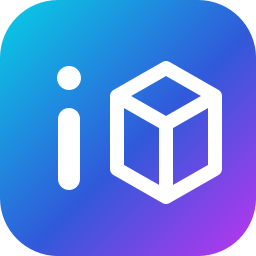
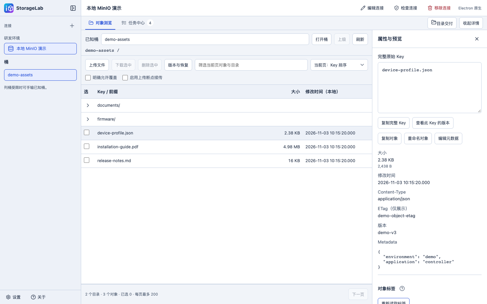
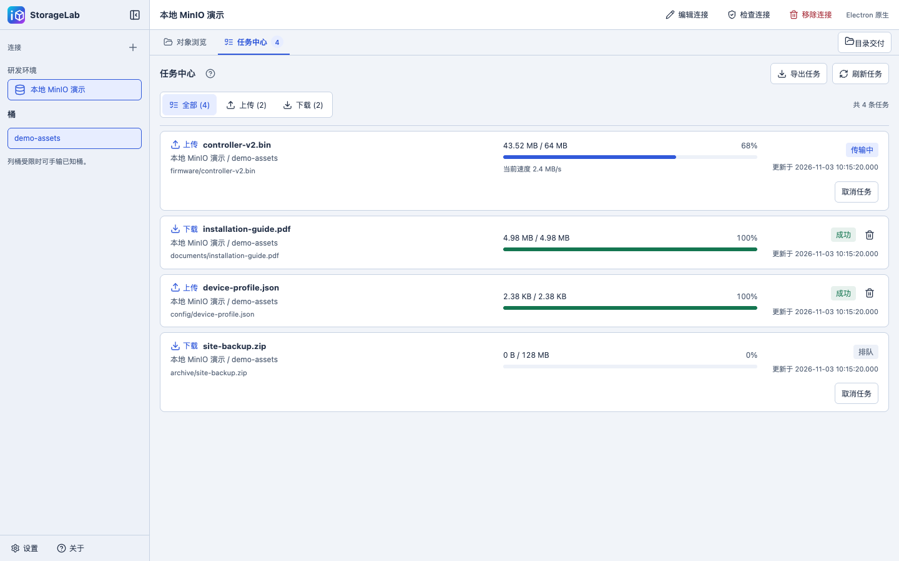
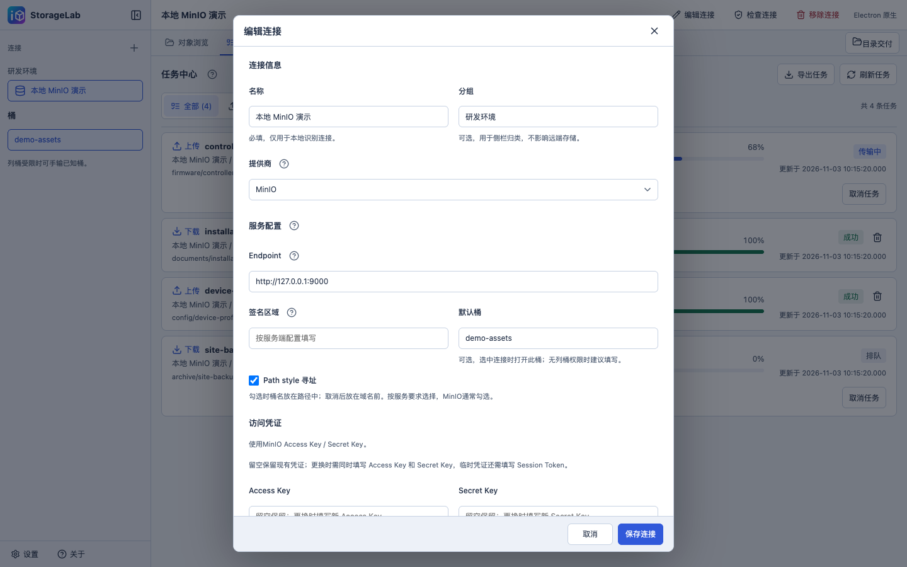

<p align="center"></p>

# StorageLab

[简体中文](README.md) · English

**An open-source MinIO / S3 desktop client and multi-provider object storage manager.** Browse buckets and objects, queue uploads and downloads, inspect versions, generate presigned sharing URLs, and verify directory deliveries with SHA-256 manifests.

[Website](https://storagelab.ineedfull.com/) · [Downloads](https://storagelab.ineedfull.com/downloads/) · [User guide](docs/user-guide.md) · [GitHub](https://github.com/ineedfull/ineed-storagelab) · [Gitee](https://gitee.com/ineedfull/ineed-storagelab) · [Quick start (中文)](docs/quick-start.md)

[](docs/images/readme/objects.webp)

## Object storage providers

| Integration | Providers |
| --- | --- |
| Official native SDK | Alibaba Cloud OSS, Huawei Cloud OBS, Tencent Cloud COS, Volcengine TOS |
| S3 protocol | MinIO, generic S3-compatible services, Amazon S3, Qiniu Kodo, Cloudflare R2, Backblaze B2, DigitalOcean Spaces, Wasabi |

These are configurable connection options. Tags, versions, conditional copies and other operations depend on provider capabilities and account permissions. Local MinIO and isolated protocol tests do not establish certification against every real cloud account. See the [provider guide](docs/cloud-providers.md) and [native SDK guide](docs/native-providers.md).

## Common workflows

- **Manage connections:** organize endpoints, signing regions and default buckets; use read-only connections and encrypted credential storage, or explicitly choose credentials for the current session only.
- **Browse and preview:** navigate object prefixes and pages, filter the current page, inspect the exact object key, size and metadata, and preview supported text, JSON and bitmap formats.
- **Transfer files:** manage upload/download queues, filter by direction, cancel or retry tasks, and open a downloaded file or its local folder.
- **Maintain objects:** copy within a bucket, rename with safeguards, edit metadata and tags, generate presigned URLs, and inspect, download or restore specific versions where supported.
- **Resume multipart uploads:** explicitly enable upload resume, then reselect a file with matching content to continue after validation.
- **Verify directory deliveries:** upload a directory or download a prefix, verify each file with SHA-256, and export a JSON manifest including successful, skipped and failed items.

## Screenshots

These screenshots show the Chinese UI with synthetic data in an isolated browser test bridge. Version and directory-delivery views from the native development application are available in the [Chinese README](README.md#界面预览); the [image notes](docs/images/readme/README.md) document their dates and origins. Click an image to enlarge it.

| Transfer tasks | Provider connection settings |
| --- | --- |
| [](docs/images/readme/tasks.webp) | [](docs/images/readme/connection.webp) |

## Get started

1. Choose a desktop package from the [download page](https://storagelab.ineedfull.com/downloads/).
2. Create a connection, select the provider and enter the endpoint and credentials.
3. Set the signing region as required by the service. Enter a known default bucket if your account cannot list all buckets.
4. Browse objects and start uploads, downloads or previews. Use directory delivery for batches requiring content verification.

Long-term access keys usually do not require a session token; temporary STS credentials require the associated token. Connection groups organize local entries and do not change remote storage.

StorageLab currently uses Vue and Electron. Electron bundles Chromium and uses relatively more memory and disk space. There is currently no Tauri implementation. Package signing and actual platform verification are documented in the download page and [packaging guide](docs/desktop-packaging.md).

## Run from source

Use Node.js 22.16+, npm and the repository lockfile:

```sh
npm ci
npm run dev:electron
```

`npm run dev` provides a visual browser preview; the production browser preview does not connect to real object storage.

```sh
npm test
npm run build
npm run test:ui
```

Real MinIO integration and native Electron tests require private, isolated configuration. Follow the [development guide](docs/development.md) and [verification guide](docs/verification.md), and use dedicated test buckets. The [user guide](docs/user-guide.md) and detailed product guides are currently in Chinese.

## Contribute and license

See [CONTRIBUTING](CONTRIBUTING.md), the [code of conduct](CODE_OF_CONDUCT.md) and [security reporting](SECURITY.md). Include the OS, version and reproduction steps in reports, and remove access keys, tokens and sensitive object data.

Original project source is licensed under [Apache-2.0](LICENSE), except where another license is specified. See [NOTICE](NOTICE) and [third-party notices](THIRD_PARTY_NOTICES.md). Product names and logos are not licensed as trademarks by the source license. Contact: [xiaopanghhh@163.com](mailto:xiaopanghhh@163.com).

## More Ineed tools

| Tool | Purpose | Website | Source |
| --- | --- | --- | --- |
| MQTT Tool | MQTT client with independent JSON/Text/HEX views per subscription and message scenario tests | [Website](https://mqtt.ineedfull.com/) | [GitHub](https://github.com/ineedfull/ineed-mqtt-tool) · [Gitee](https://gitee.com/ineedfull/ineed-mqtt-tool) |
| LinkLab | Serial and industrial protocol testing, simulators and device acceptance | [Website](https://linklab.ineedfull.com/) | [GitHub](https://github.com/ineedfull/ineed-linklab) · [Gitee](https://gitee.com/ineedfull/ineed-linklab) |
| NetTool | IP address management, network planning, diagnostics and project handover | [Website](https://nettool.ineedfull.com/) | [GitHub](https://github.com/ineedfull/ineed-net-tool) · [Gitee](https://gitee.com/ineedfull/ineed-net-tool) |
| StorageLab | MinIO/S3 and multi-provider object storage management with directory verification | [Website](https://storagelab.ineedfull.com/) | [GitHub](https://github.com/ineedfull/ineed-storagelab) · [Gitee](https://gitee.com/ineedfull/ineed-storagelab) |

Ineed: [www.ineedfull.com](https://www.ineedfull.com/).
