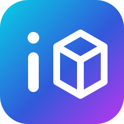
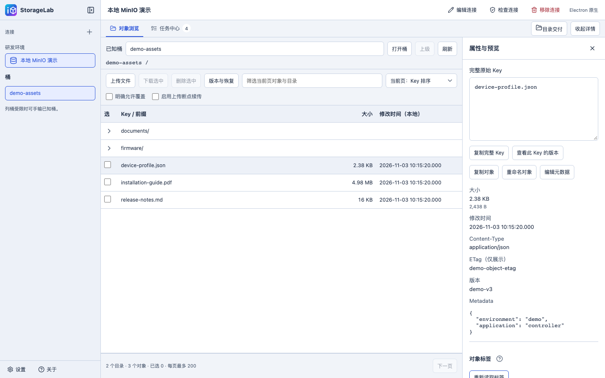
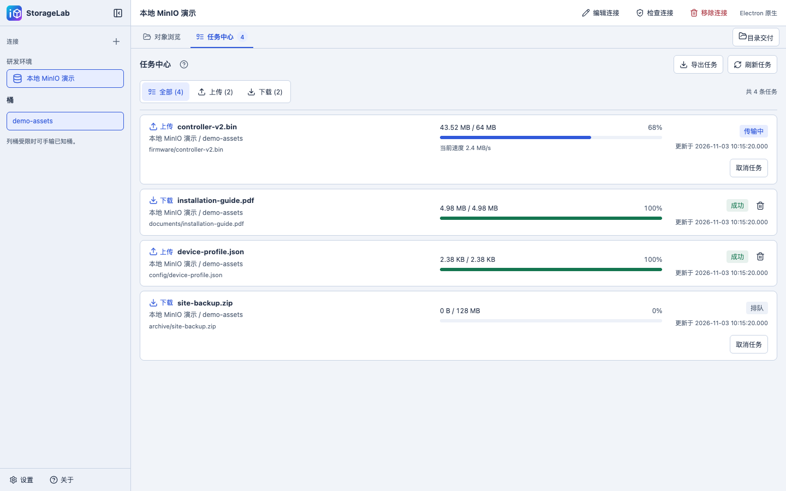
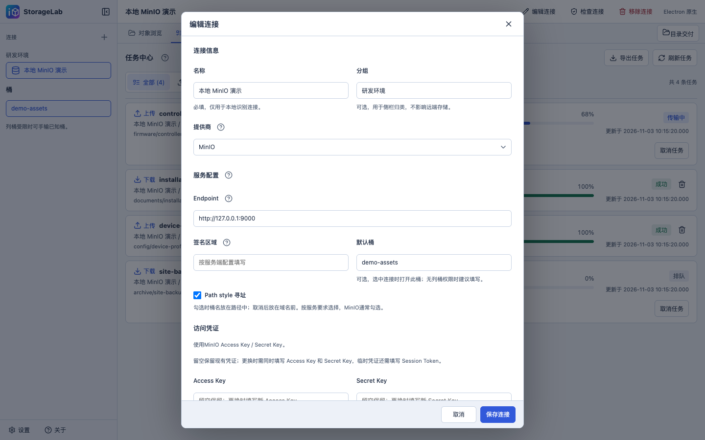
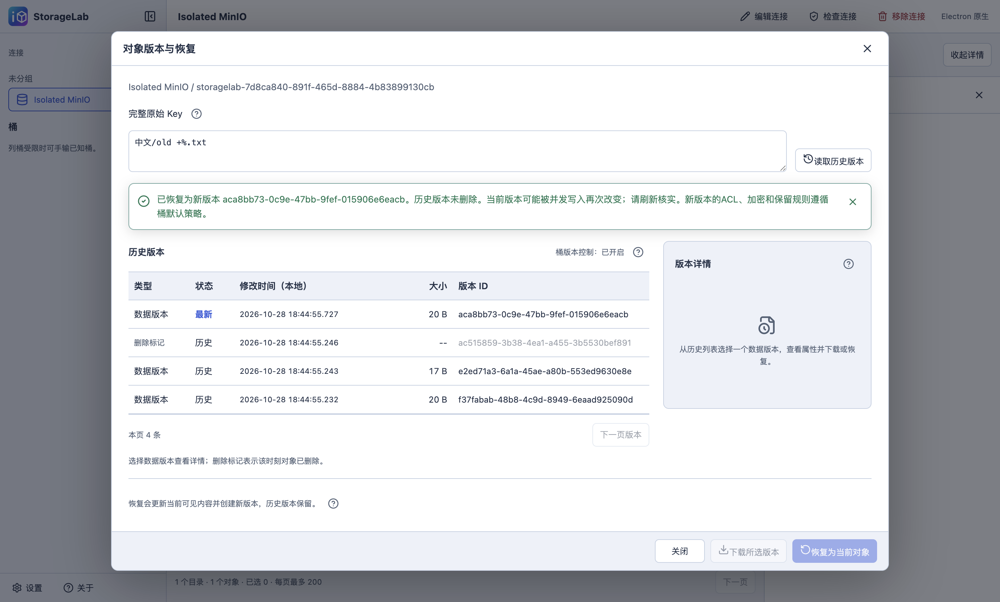
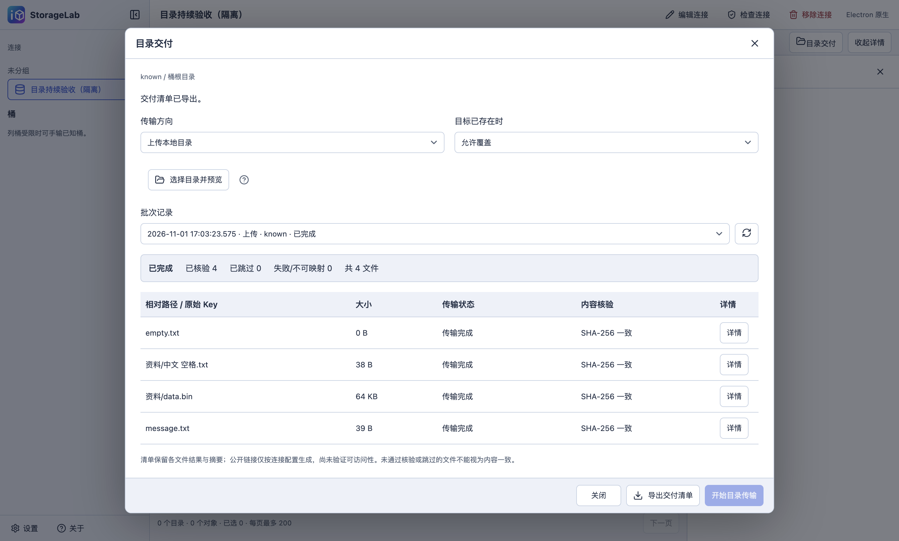
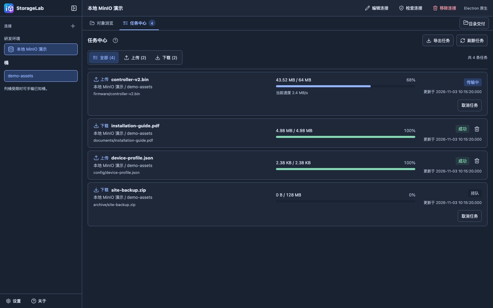

<p align="center"></p>

# StorageLab

简体中文 · [English](README.en.md)

**开源 MinIO / S3 客户端与多厂商对象存储管理工具。** 支持 Amazon S3、阿里云 OSS、华为云 OBS、腾讯云 COS、火山引擎 TOS 和 S3 兼容存储。在同一个桌面工作台浏览对象、上传下载、管理版本、生成预签名分享链接，并用 SHA-256 目录交付清单核对文件内容。

[产品官网](https://storagelab.ineedfull.com/) · [下载安装](https://storagelab.ineedfull.com/downloads/) · [使用指南](docs/user-guide.md) · [开发指南](docs/development.md)

[](docs/images/readme/objects.webp)

## 支持哪些对象存储

| 接入方式 | 提供商 |
| --- | --- |
| 官方原生 SDK | 阿里云 OSS、华为云 OBS、腾讯云 COS、火山引擎 TOS |
| S3 协议 | MinIO、通用 S3、Amazon S3、七牛云 Kodo、Cloudflare R2、Backblaze B2、DigitalOcean Spaces、Wasabi |

这些是当前可配置的接入入口。标签、版本、条件复制等能力受提供商和账号权限约束；已有本机 MinIO 与隔离协议测试，不能将预设入口视为所有真实云账号已通过认证。详见[厂商接入](docs/cloud-providers.md)和[原生 SDK](docs/native-providers.md)。

## 常用工作流

- **管理连接**：分组整理 Endpoint、签名区域与默认桶，支持只读连接；凭证加密保存，或明确选择仅在本次会话使用。
- **浏览与预览**：前缀导航、分页与当前页筛选；查看完整原始 Key、容量、Metadata，安全预览文本、JSON 与常见位图。
- **处理传输任务**：上传/下载统一队列，按方向筛选、取消、重试；记录下载位置，打开本地文件或所在目录。
- **维护对象**：同桶复制、受控重命名、元数据与标签编辑、签名分享，以及对象版本查询、指定版本下载与恢复。
- **传输大文件**：显式开启分片上传续传；重新选择相同内容文件，校验后恢复。
- **核对目录交付**：目录上传或前缀下载，逐文件完整 SHA-256 校验并导出 JSON 清单，保留成功、跳过和失败证据。

## 界面预览

对象浏览、任务与连接界面是 2026-11-03 当前源码在浏览器隔离测试桥中渲染的演示，文件和进度均为合成数据。版本恢复与目录交付来自历史原生开发宿主；具体日期与环境见[图片来源](docs/images/readme/README.md)。点击图片查看原图。

| 上传与下载任务中心 | 连接参数与提供商 |
| --- | --- |
| [](docs/images/readme/tasks.webp) | [](docs/images/readme/connection.webp) |

| 对象历史版本与恢复 | 目录交付与 SHA-256 清单 |
| --- | --- |
| [](docs/images/readme/object-versions.webp) | [](docs/images/readme/directory-delivery.webp) |


深色主题下的任务中心：

[](docs/images/readme/tasks-dark.webp)

## 开始使用

1. 创建连接，选择提供商并填写 Endpoint 与凭证。
2. 按服务要求填写签名区域；有已知桶时可直接填默认桶，无需列出账号全部桶。
3. 打开桶，浏览对象并执行上传、下载或预览。
4. 多文件交付时打开「目录交付」，先预览，再执行和导出核验清单。

长期 Access Key 通常不需要 Session Token；临时 STS 凭证才需要一起填写。连接分组只用于本地归类，不改变远端存储。

当前为 Vue + Electron，Electron 自带 Chromium，资源占用相对较大。没有 Tauri 版本；测试安装包的签名、平台和实机验收状态见[发布说明](docs/releases/2026-10-30.md)。

## 从源码运行

需要 Node.js 22.16+。在仓库根目录执行：

```sh
npm ci
npm run dev:electron
```

`npm run dev` 仅启动外观预览，生产浏览器预览不会连接真实存储。单元测试、浏览器演示和原生验收分别运行：

```sh
npm test
npm run build
npm run test:ui
```

真实 MinIO 与 Electron 原生测试需要私有隔离配置，前提见[开发指南](docs/development.md)，不要使用发布桶或客户桶运行测试。

## 文档导航

| 想了解什么 | 入口 |
| --- | --- |
| 连接与基础操作 | [用户指南](docs/user-guide.md)、[厂商接入](docs/cloud-providers.md) |
| 标签、版本和元数据 | [对象标签](docs/object-tags.md)、[版本与恢复](docs/object-versions.md)、[对象管理](docs/object-management.md) |
| 续传、目录与本地文件 | [断点续传](docs/resumable-upload.md)、[目录交付](docs/directory-delivery.md)、[任务文件](docs/task-files.md) |
| UI 到 SDK / SQLite 的调用链 | [架构与维护](docs/architecture.md)、[工作台](docs/ui.md) |
| 测试与发布 | [功能验证](docs/verification.md)、[发布前验收](docs/release-acceptance.md)、[桌面打包](docs/desktop-packaging.md) |

## 参与和许可

欢迎反馈问题、改进文档或提交代码，入口见[贡献指南](CONTRIBUTING.md)、[社区交流约定](CODE_OF_CONDUCT.md)与[安全报告](SECURITY.md)。

除文件或目录另有说明外，项目原创源码采用 [Apache License 2.0](LICENSE)，相关署名见 [NOTICE](NOTICE)。第三方组件、字体与供应商代码保留原许可，详见[第三方声明](THIRD_PARTY_NOTICES.md)。产品名称和 Logo 的商标权不随源码许可证授予。

## 官网与交流

产品官网：[storagelab.ineedfull.com](https://storagelab.ineedfull.com/)；Ineed 主站：[www.ineedfull.com](https://www.ineedfull.com/)。

使用中遇到问题，欢迎扫码加微信，添加时请备注「StorageLab」。反馈时请附系统、版本、操作步骤，并隐藏密钥、令牌及现场敏感信息。

<a href="docs/images/readme/wechat-qr.png"></a>

也可以发邮件：[xiaopanghhh@163.com](mailto:xiaopanghhh@163.com)。

## 同系列开源工具

| 工具 | 主要用途 | 产品官网 | 源码 |
| --- | --- | --- | --- |
| MQTT Tool | MQTT 客户端、按订阅独立显示 JSON/Text/HEX、设备消息场景 | [官网](https://mqtt.ineedfull.com/) | [GitHub](https://github.com/ineedfull/ineed-mqtt-tool) · [Gitee](https://gitee.com/ineedfull/ineed-mqtt-tool) |
| LinkLab | 串口与工业协议联调、客户端/模拟服务端、设备验收 | [官网](https://linklab.ineedfull.com/) | [GitHub](https://github.com/ineedfull/ineed-linklab) · [Gitee](https://gitee.com/ineedfull/ineed-linklab) |
| NetTool | IP 地址管理、网络工程规划与诊断、现场交付 | [官网](https://nettool.ineedfull.com/) | [GitHub](https://github.com/ineedfull/ineed-net-tool) · [Gitee](https://gitee.com/ineedfull/ineed-net-tool) |
| StorageLab | MinIO/S3 与多厂商对象存储管理、目录交付校验 | [官网](https://storagelab.ineedfull.com/) | [GitHub](https://github.com/ineedfull/ineed-storagelab) · [Gitee](https://gitee.com/ineedfull/ineed-storagelab) |

Ineed 主站：[www.ineedfull.com](https://www.ineedfull.com/)。
