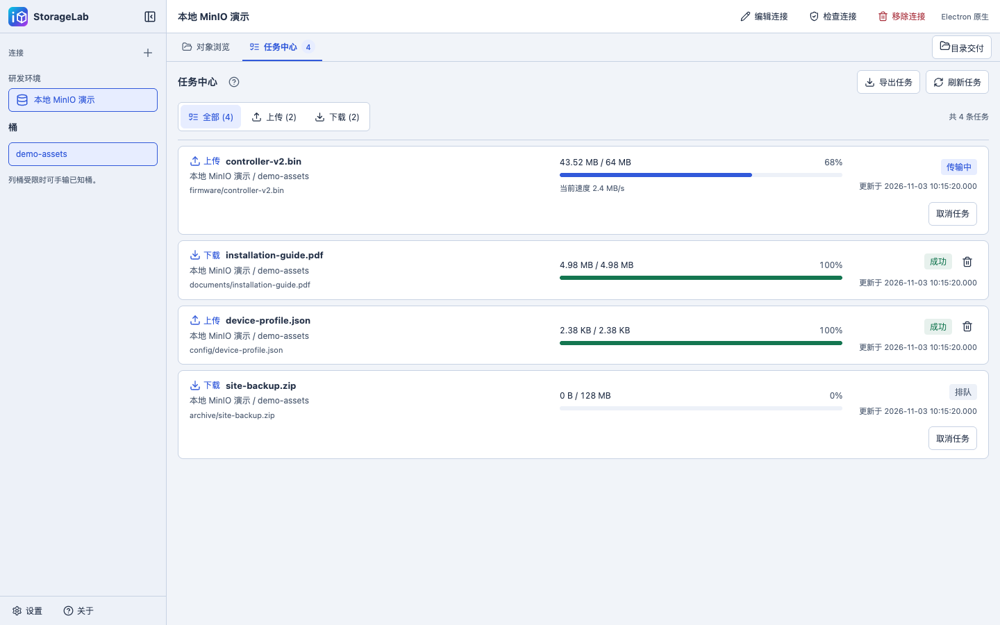

# StorageLab 快速上手

[返回首页](../README.md) · [下载安装](https://storagelab.ineedfull.com/downloads/) · [用户指南](user-guide.md)

本指南按当前仓库源码整理。官网安装包可能早于源码修复；请在「关于」核对版本及构建信息，具体下载文件的发布日期以下载页为准。

目标：连接自己的测试 MinIO，上传一个小文件、预览并下载，再找到本地文件。其他厂商的 Endpoint 和凭证映射见[云存储接入](cloud-providers.md)。

## 1. 准备桌面版与测试桶

StorageLab 当前只有 Electron 版。按下载页的系统与 CPU 架构选择安装包；资源、签名及平台验证范围见[打包说明](desktop-packaging.md)。浏览器预览仅展示外观，不连接真实存储。

请先由管理员准备独立测试桶及对应权限的 Access Key / Secret Key。StorageLab 当前不创建桶；公开下载域名和 MinIO 管理控制台地址也不一定是 S3 API Endpoint。

## 2. 新建 MinIO 连接

下列值是填写说明，不是可直接登录的公共测试账号：

| 字段 | 填写方式 |
| --- | --- |
| 名称 | 例如「我的 MinIO 测试」 |
| 分组 | 可选，本地整理连接用，例如「研发测试」 |
| 提供商 | MinIO |
| Endpoint | 管理员提供的完整 API 地址，例如 `https://minio.example.com`；不填控制台地址、桶名或对象路径 |
| 签名区域 | 按服务配置填写；不确定时向管理员确认，不把其他云的地域照搬过来 |
| Path style | MinIO 通常开启，按服务实际要求调整 |
| 默认桶 | 已存在且有权限的测试桶名，例如 `my-test-bucket`，与 Endpoint 分开填写 |
| Access Key / Secret Key | 该测试桶授权账号的凭证 |
| Session Token | 长期凭证通常留空；临时凭证需一起填写且注意有效期 |
| 只读 | 只浏览时开启；本轮上传练习需要写权限并关闭只读 |
| 公开地址 | 本轮不需要，留空；它与签名下载不同 |

操作系统安全后端可用时可加密保存凭证；也可明确选择只在本次会话使用，退出后需重填。首次启动若出现系统钥匙串授权，它用于凭证保护，不是另设一个应用登录密码。

保存后检查连接并打开默认桶。没有全账号列桶权限时，仍可以填写有权限的已知桶；连接检查通过也不等于拥有上传、标签或版本恢复权限。

## 3. 上传、预览与下载

1. 本地新建 `hello-storagelab.txt`，内容为 `hello StorageLab`。进入测试桶的一个专用前缀，或直接使用独立测试桶根目录。
2. 点击上传并选择该文件。本轮不启用续传；如发现同名对象，换一个新文件名。MinIO 接入若提示不支持原子「不覆盖」，需先确认独立测试桶中的目标 Key 没有重要对象，再明确选择允许覆盖后上传；换新文件名本身不能提供原子不覆盖保证。
3. 到「任务」查看上传是否完成，再回对象浏览刷新。选中对象，检查原始 Key、大小和文本预览。
4. 下载该对象，选择一个空的本地目录；到任务中心切换为下载任务，确认完成后打开文件或所在目录，核对内容。

普通下载完成表示传输流、字节数及本地提交完成，不代表额外 SHA-256 内容校验。需要目录级交付证据时使用[目录交付](directory-delivery.md)，先预览映射，再传输并导出核验清单。

本机下载文件与远端对象彼此独立。删除任务记录、删除本地文件和删除远端对象是不同操作，按确认窗口核对范围；练习结束后再按需清理测试文件。

## 4. 换成其他厂商时

新建连接选择 OSS / OBS / COS / TOS 时，优先使用名称带「原生」的入口，并填写厂商原生 Endpoint。填写服务地域后，可以点击「应用提供商配置」生成参数，再核对实际桶地域与地址。切换提供商下拉本身不会自动替换所有地址。

OSS 不能把 `s3.oss-…` 地址填给原生接入；TOS 同样区分原生与 `tos-s3-…` 地址。R2 等继续使用厂商的 S3 接口。具体厂商能力与权限以[接入指南](cloud-providers.md)为准，存在预设不代表所有云账号已实测通过。

## 5. 遇到问题先查这里

| 现象 | 检查方法 |
| --- | --- |
| Endpoint 打开是管理登录页 | 向管理员确认 S3 API 地址和端口；不要用控制台地址代替 |
| 无权列桶 | 填写有权限的默认桶，再尝试打开；不必先获取全账号列桶权限 |
| 签名失败 | 核对提供商、API 地址、区域、寻址方式、凭证与本机时间；临时凭证检查 Token 和到期时间 |
| 能浏览但不能上传 | 核对连接是否只读、桶/前缀写权限以及覆盖策略 |
| 页面筛选找不到对象 | 筛选只作用当前页，检查前缀和后续分页 |
| 下载后无法打开本地文件 | 查看任务记录的保存位置，确认文件没有被移动或删除；重启前后的文件授权范围见[任务文件](task-files.md) |
| 网络中断后操作结果不明 | 先刷新核对远端；普通下载需重新下载，不能假定已成功或直接恢复断点 |

反馈入口：[GitHub Issues](https://github.com/ineedfull/ineed-storagelab/issues) · [Gitee Issues](https://gitee.com/ineedfull/ineed-storagelab/issues)。附版本、系统/架构、提供商、操作类型、脱敏错误码和最小复现步骤；不要公开 Access Key、Secret Key、Session Token 或有效签名 URL。安全问题见[安全报告](../SECURITY.md)。
